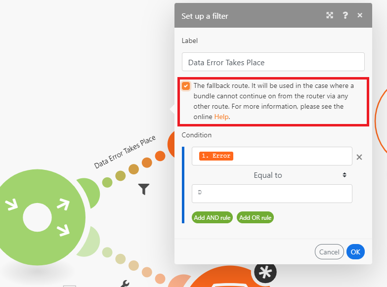
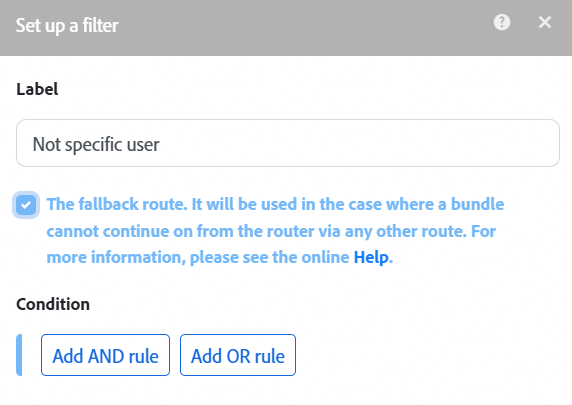

# ルーターモジュールの追加とルートの設定

ルーターモジュールを使用すると、シナリオを複数のルートに分岐し、各ルート内のデータを異なる方法で処理できます。 ルーターモジュールがバンドルを受信すると、ルーターモジュールにルートが取り付けられた順序で、接続されている各ルートに転送されます。

ルートは、並列ではなく順番に処理されます。 バンドルは、前のルートで完全に処理されるまで、次のルートに送信されません。

>[!NOTE]
>
>Workfront Fusionは、シナリオエディターを新しいエクスペリエンスに移行中です。 この移行中は、従来のエクスペリエンスと新しいエクスペリエンスの両方を利用でき、いつでも切り替えることができます。 新しいエクスペリエンスを使用することをお勧めします。 詳しくは、シナリオエディターの記事「[新しいエクスペリエンスと従来のエクスペリエンス ](/help/workfront-fusion/get-started-with-fusion/navigate-fusion/scenario-editor.md#new-and-classic-experiences)」を参照してください。

## アクセス要件

+++ 展開すると、この記事の機能のアクセス要件が表示されます。

<table style="table-layout:auto">
 <col> 
 <col> 
 <tbody> 
  <tr> 
   <td role="rowheader">Adobe Workfront パッケージ</td> 
   <td> 
任意の Adobe Workfront Workflow パッケージと任意の Adobe Workfront Automation および Integration パッケージ

Workfront Ultimate

Workfront Fusion を追加購入した Workfront Prime および Select パッケージ。
 </td> 
  </tr> 
  <tr data-mc-conditions=""> 
   <td role="rowheader">Adobe Workfront ライセンス</td> 
   <td> 
標準

Work またはそれ以上
 </td> 
  </tr> 
  <tr> 
   <td role="rowheader">製品</td> 
   <td>
   
組織が Workfront Automation および Integration を含まない Select またはPrime Workfront パッケージを持っている場合は、Adobe Workfront Fusion を購入する必要があります。</li></ul>
   </td> 
  </tr>
 </tbody> 
</table>

この表の情報について詳しくは、[ドキュメントのアクセス要件](/help/workfront-fusion/references/licenses-and-roles/access-level-requirements-in-documentation.md)を参照してください。

+++

## シナリオへのルーターモジュールの追加

ルートを設定する前に、ルーターモジュールを追加する必要があります。

* [新しいエクスペリエンスでシナリオにルーターモジュールを追加する（推奨）](#add-a-router-module-to-a-scenario-in-the-new-experience-recommended)
* [クラシック エクスペリエンスのシナリオにルーターモジュールを追加する](#add-a-router-module-to-a-scenario-in-the-classic-experience)

### 新しいエクスペリエンスでシナリオにルーターモジュールを追加する（推奨）

1. 左側のパネルの「**[!UICONTROL シナリオ]**」タブをクリックします。
1. ルーターを追加するシナリオを選択します。
1. シナリオの任意の場所をクリックして、シナリオエディターに入ります。
1. ルーターを追加するモジュールの右端にカーソルを合わせ、表示されたら「**[!UICONTROL 別のモジュールを追加]**」をクリックします。 開いたリストで、**[!UICONTROL 組み込み]** カテゴリを選択し、**[!UICONTROL フロー制御]** > **[!UICONTROL ルーター]**&#x200B;を選択します。

   または

   2つのモジュール間にルーターモジュールを挿入するには、2つのモジュールを接続するパスを右クリックし、「**[!UICONTROL ルーターを追加]**」を選択します。

   

1. ルータの右端にマウスポインターを置いてモジュールを追加することで、任意のモジュールを追加するのと同様に、ルータへの最初のルートを追加します。
1. 別のルートを追加するには、ルーターモジュールをクリックします。 ルートが表示されます。 必要に応じてこのルートにモジュールを追加します。

   必要なだけルートを追加できます。

1. ルートの順序を確認するには、各ルートのラベルを確認します。 ルート 1が最初に実行され、次にルート 2が実行されます。

   または

   コントロール領域の&#x200B;**自動整列** アイコン をクリックします。

   ルートは、実行される順に配置されます。 一番上のルートが最初に実行されます。

1. （オプション）ルートの順序を変更するには、ルーターモジュールを右クリックし、**Order routes**&#x200B;を選択します。 ルートを実行する順序でドラッグ&amp;ドロップします。 ルートは、ルータに続く最初のモジュール（ルートの最初のモジュール）によってマークされます。
1. （オプション）ルートを無効にするには、ルーターからそのルートに至るパスを右クリックし、**ルートを無効にする**&#x200B;を選択します。

   無効なルートには、ルーターからルート上の最初のモジュールに至るグレーのドットが表示され、無効なルート アイコン がラベルに表示されます。

1. （オプションおよび条件付き）無効なルートを有効にするには、ルートのラベルにある無効なルートアイコン をクリックします。
1. 続行[新しいエクスペリエンスのルートにフィルターを追加](#add-a-filter-to-a-route-in-the-new-experience-recommended)します。

### クラシック エクスペリエンスのシナリオにルーターモジュールを追加する

1. 左側のパネルの「**[!UICONTROL シナリオ]**」タブをクリックします。
1. ルーターを追加するシナリオを選択します。
1. シナリオの任意の場所をクリックして、シナリオエディターに入ります。
1. シナリオエディターで、ルーターを追加するモジュールの右側のハンドルをクリックし、表示されるモジュールのリストで&#x200B;**[!UICONTROL フロー制御]** > **ルーター**&#x200B;を選択します。

   

   または

   2つのモジュール間にルーターモジュールを挿入するには、2つのモジュールを接続するルートの下にあるレンチアイコンをクリックし、メニューから「**[!UICONTROL ルーターを追加]**」を選択します。

   
1. ルータの右側のハンドルをクリックしてモジュールを追加し、任意のモジュールを追加するのと同様に、ルータへの最初のルートを追加します。
1. 別のルートを追加するには、ルーターモジュールをクリックします。 ルートが表示されます。 必要に応じてこのルートにモジュールを追加します。

   必要なだけルートを追加できます。

1. ルートの順序を確認するには、各ルートのラベルを確認します。 ルート 1が最初に実行され、次にルート 2が実行されます。

   または

   自動整列アイコン をクリックします。

   ルートは、実行される順に配置されます。 一番上のルートが最初に実行されます。

1. （オプション）ルートの順序を変更するには、ルーターモジュールを右クリックし、**ルートの順序**&#x200B;を選択します。ルートを実行する順序にドラッグ&amp;ドロップします。 ルートは、ルータに続く最初のモジュール（ルートの最初のモジュール）によってマークされます。

   

1. （オプション）ルートを無効にするには、ルーターからそのルートに導くドットを右クリックし、**ルートを無効にする**&#x200B;を選択します。

   無効なルートには、ルーターからルート上の最初のモジュールに至るグレーのドットが表示され、無効なルート アイコン がラベルに表示されます。

1. （オプションおよび条件付き）無効なルートを有効にするには、ルートのラベルにある無効なルートアイコン をクリックします。
1. 引き続き[ クラシック エクスペリエンスのルートにフィルターを追加](#add-a-filter-to-a-route-in-the-classic-experience)します。

## ルートへのフィルターの追加

ルーターモジュールの後のルートにフィルターを配置して、バンドルをフィルタリングできます。 フィルターを通過するバンドルのみが、ルート上のモジュールによって処理されます。

データが複数のルートのフィルターを通過する場合、データは両方のルートで処理されます。 一番上のルートが最初にデータを処理します。

フィルターを含むルーターには、ルートラベルにフィルターアイコン が表示されます。

* [新しいエクスペリエンスのルートにフィルターを追加する（推奨）](#add-a-filter-to-a-route-in-the-new-experience-recommended)
* [クラシックエクスペリエンスのルートにフィルターを追加する](#add-a-filter-to-a-route-in-the-classic-experience)

### 新しいエクスペリエンスのルートにフィルターを追加する（推奨）

1. 左側のパネルの「**[!UICONTROL シナリオ]**」タブをクリックします。
1. フィルターを追加するシナリオを選択します。
1. シナリオの任意の場所をクリックして、シナリオエディターに入ります。
1. フィルターを設定するパスを左クリックします。 これは、ルータ モジュールとルートの最初のモジュールとの間のパスです。

   **[!UICONTROL フィルターの設定]** ウィンドウが直接開きます。

1. 表示されるパネルの「ラベル」フィールドに、ラベルを追加します。 このラベルはシナリオに表示されます。
1. フィルター条件を設定します。

   詳しくは、[シナリオへのフィルターの追加](/help/workfront-fusion/create-scenarios/add-modules/add-a-filter-to-a-scenario.md)を参照してください。

   

1. **[!UICONTROL OK]**&#x200B;をクリックして、フィルター設定を保存します。
1. （条件付き）フィルター名が長すぎてラベルに収まらない場合は、ラベルにカーソルを合わせると、名前の全体が表示されます。

1. 新しいエクスペリエンスで[ フォールバックルートの設定](#configure-a-fallback-route-in-the-new-experience-recommended)を続行します。

### クラシックエクスペリエンスのルートにフィルターを追加する

1. 左側のパネルの「**[!UICONTROL シナリオ]**」タブをクリックします。
1. フィルターを追加するシナリオを選択します。
1. シナリオの任意の場所をクリックして、シナリオエディターに入ります。
1. フィルターを設定するパスのレンチアイコン をクリックします。 これは、ルータ モジュールとルートの最初のモジュールとの間のパスです。
1. **フィルターを設定を選択します。**
1. 表示されるパネルの「ラベル」フィールドに、ラベルを追加します。 このラベルはシナリオに表示されます。
1. フィルター条件を設定します。

   詳しくは、[シナリオへのフィルターの追加](/help/workfront-fusion/create-scenarios/add-modules/add-a-filter-to-a-scenario.md)を参照してください。

1. **[!UICONTROL OK]**&#x200B;をクリックして、フィルター設定を保存します。
1. （条件付き）フィルター名が長すぎてラベルに収まらない場合は、ラベルにカーソルを合わせると、名前の全体が表示されます。

1. 引き続き[従来のエクスペリエンスでフォールバックルートを設定](#configure-a-fallback-route-in-the-classic-experience)します。

## フォールバックルートの設定

フォールバックルートは、フィルターを別のルートに渡さないバンドルで実行されるルートです。

フォールバックルートでは、ラベルに「フォールバック」が表示されます。

フィルターパネルでフォールバックルートを有効にすることができます。

* [新しいエクスペリエンスでのフォールバックルートの設定（推奨）](#configure-a-fallback-route-in-the-new-experience-recommended)
* [クラシック エクスペリエンスでのフォールバックルートの設定](#configure-a-fallback-route-in-the-classic-experience)

### 新しいエクスペリエンスでのフォールバックルートの設定（推奨）

1. 左側のパネルの「**[!UICONTROL シナリオ]**」タブをクリックします。
1. フォールバックルートを追加するシナリオを選択します。
1. シナリオの任意の場所をクリックして、シナリオエディターに入ります。
1. フィルターを設定するパスを左クリックします。 これは、ルータ モジュールとルートの最初のモジュールとの間のパスです。

   **[!UICONTROL フィルターの設定]** ウィンドウが直接開きます。

1. 表示されるパネルの「ラベル」フィールドに、ラベルを追加します。 このラベルはシナリオに表示されます。
1. フォールバックルートチェックボックスを有効にします。

   

1. **[!UICONTROL OK]**&#x200B;をクリックして、フィルター設定を保存します。

フォールバックルートのラベルには、**フォールバック**&#x200B;が緑色で表示されます。

### クラシック エクスペリエンスでのフォールバックルートの設定

1. 左側のパネルの「**[!UICONTROL シナリオ]**」タブをクリックします。
1. フォールバックルートを追加するシナリオを選択します。
1. シナリオの任意の場所をクリックして、シナリオエディターに入ります。
1. フィルターを設定するパスのレンチアイコン をクリックします。 これは、ルータ モジュールとルートの最初のモジュールとの間のパスです。
1. **フィルターを設定を選択します。**
1. 表示されるパネルの「ラベル」フィールドに、ラベルを追加します。 このラベルはシナリオに表示されます。
1. フォールバックルートチェックボックスを有効にします。

   

1. **[!UICONTROL OK]**&#x200B;をクリックして、フィルター設定を保存します。

フォールバックルートは、ルーターモジュールで別の矢印でマークされます。

## ルーターを折りたたむ

>[!NOTE]
>
>この機能は、新しいシナリオエディターエクスペリエンスでのみ使用できます。

新しいエクスペリエンスでは、ルーターを折りたたんで、ルートを一時的に非表示にすることができます。 これは、大規模なシナリオで便利です。

1. シナリオエディターの編集モードでシナリオを開きます。
1. 折りたたむルーターを右クリックし、**折りたたみルート**&#x200B;を選択します

折り畳まれたルータには、非表示の警告やエラーの重大度を含め、非表示になっているルートやモジュールの数が表示されます。

ルーターを折りたたむと、何も削除または無効にされません。 検索、検証、ライブトレイル、実行履歴により、折り畳まれたルーターの中にモジュールを表示する必要がある場合に、そのルーターを自動的に展開できます。

折り畳まれた状態はシナリオと共に保存され、取り消しとやり直しで動作します。 シナリオ実行を確認すると、完全なシナリオが常に表示されます。

## 例：`if/else` ユースケース

>[!BEGINSHADEBOX]

フォールバックルートの一般的な使用例は、条件が満たされた場合は1つのルートで、満たされていない場合は別のルートでフローを続行することです。 次の手順に従います。

この例では、最初のルートはフィルターで設定されています。 これは、`if` コンポーネントを表します。

2つ目のルートは、フォールバックルートとして設定されます。 これは、`else` コンポーネントを表します。

>[!ENDSHADEBOX]
