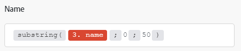
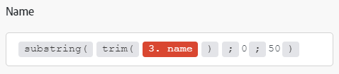
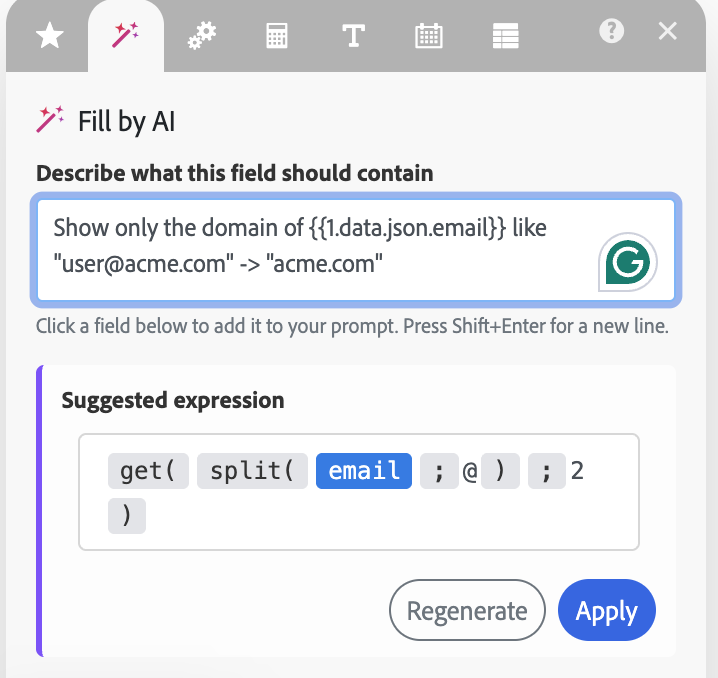
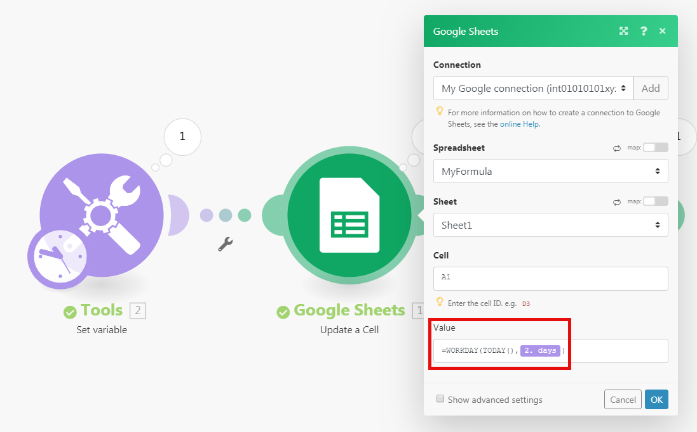
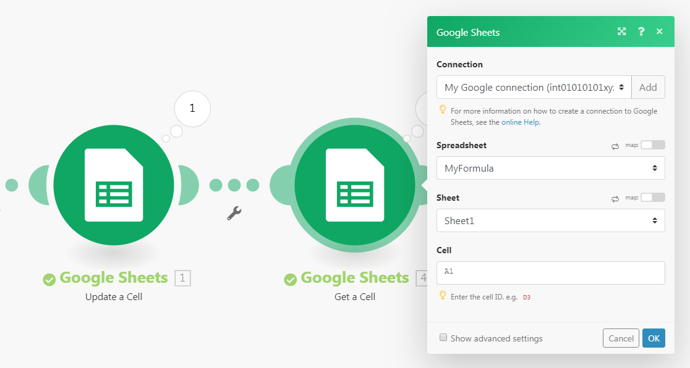

# 組み込み関数を使用したアイテムのマッピング

Workfront Fusionには、シンプルな数式や複雑な数式を作成するための関数が組み込まれています。 これらの関数は、配列、文字列、数値、および以前のモジュールのデータに対する関数など、様々なユースケースをカバーします。

さらに、シナリオがデータの変換と操作に使用できるカスタム関数とパッケージを作成できます。

カスタム関数の詳細と手順については、[&#x200B; カスタム関数を使用したデータのマッピング &#x200B;](/help/workfront-fusion/create-scenarios/map-data/map-using-custom-functions.md)を参照してください。

関数パッケージの詳細と手順については、[&#x200B; カスタム関数パッケージの使用](/help/workfront-fusion/create-scenarios/map-data/use-custom-function-packages.md)を参照してください。

## アクセス要件

+++ 展開すると、この記事の機能のアクセス要件が表示されます。

<table style="table-layout:auto">
 <col> 
 <col> 
 <tbody> 
  <tr> 
   <td role="rowheader">Adobe Workfront パッケージ</td> 
   <td> 
任意の Adobe Workfront Workflow パッケージと任意の Adobe Workfront Automation および Integration パッケージ

Workfront Ultimate

Workfront Fusion を追加購入した Workfront Prime および Select パッケージ。
 </td> 
  </tr> 
  <tr data-mc-conditions=""> 
   <td role="rowheader">Adobe Workfront ライセンス</td> 
   <td> 
標準

Work またはそれ以上
 </td> 
  </tr> 
  <tr> 
   <td role="rowheader">製品</td> 
   <td>
   
<ul><li>組織が Workfront Automation および Integration を含まない Select またはPrime Workfront パッケージを持っている場合は、Adobe Workfront Fusion を購入する必要があります。</li><li>カスタム関数を使用するには、Adobe App Builder ライセンスが必要です。</ul>
   </td> 
  </tr>
 </tbody> 
</table>

この表の情報について詳しくは、[ドキュメントのアクセス要件](/help/workfront-fusion/references/licenses-and-roles/access-level-requirements-in-documentation.md)を参照してください。

+++

## 組み込み関数を使用したデータのマッピング

項目をマッピングする場合、関数を使用して単純な数式や複雑な数式を作成できます。 使用できる関数は、Excel の関数や一部のプログラミング言語の関数に似ています。

* 一般的なロジック、数学、テキスト、日付および配列を評価します。
* 条件付きロジックと項目値の変換（テキストの大文字への変換、テキストの切り抜き、日付の別の形式への変換など）を実行できます。

### フィールドに関数を挿入

フィールドに関数を挿入するには、次の手順に従います。

1. 左側のパネルの「**[!UICONTROL シナリオ]**」タブをクリックします。
1. データをマッピングするシナリオを選択します。
1. シナリオの任意の場所をクリックして、シナリオエディターに入ります。
1. 関数を挿入するフィールドをクリックします。
1. 挿入する関数を含むマッピングパネルのタブを選択します。

   パネルタブのマッピングについて詳しくは、[関数の概要](/help/workfront-fusion/get-started-with-fusion/understand-fusion/function-overview.md)を参照してください
1. 関数名をクリックします。

   または

   関数をフィールドにドラッグします。
1. 関数パラメーターを設定します。

   関数パラメーターの説明を表示するには、マッピングパネルの関数にカーソルを合わせます。

   関数とそのパラメーターについて詳しくは、[関数参照：記事インデックス &#x200B;](/help/workfront-fusion/references/mapping-panel/functions/functions-toc.md)の記事を参照してください。

1. モジュールの設定を続行するか、**OK**&#x200B;をクリックします。

>[!TIP]
>
>別のフィールドで再利用する複雑な数式を作成する場合は、組み合わせを含むフィールドをクリックし、Cmd-AまたはCtrl-Aを使用して選択し、コピーして他のフィールドに貼り付けることができます。

>[!BEGINSHADEBOX]

**例：**&#x200B;一部のデータタイプでは、ユーザーが一定の文字数以上を入力できないよう設定されています。 サブ文字列関数を使用して、値を特定の文字数に制限できます。

この例では、サブ文字列関数は、プロジェクト名を 50 文字に制限します。

>[!ENDSHADEBOX]

### 関数のネスト

関数を相互にネストすることができます。

>[!BEGINSHADEBOX]

**例：**

この例では、部分文字列関数は、トリミングされたプロジェクト名を50文字に制限します。

>[!ENDSHADEBOX]

関数をネストするには：

1. 数式を作成するフィールドをクリックします。

   マッピングパネルが開きます。

1. 追加する最初の関数をクリックします。 これは外側の機能です。 次の例の場合、これは`substring`関数です。
1. この関数で、ネストした関数の移動先をクリックします。 この例では、ネストされた関数は最初のパラメーターの場所に配置されます。
1. マッピングパネルで、ネストされた関数をクリックします。 この例では、これは`trim`関数です。
1. 必要に応じて関数の設定を続行します。
1. モジュールの設定を続行するか、**OK**&#x200B;をクリックします。

### AIで式を生成する

式の構文を自分で記述する代わりに、目的のものを平易な言語で記述できます。AIは式を生成します。 例えば、次のような質問をすることができます。

* これらの名前にはコンマを付けます。
* 期日に3日を追加します。

AIは、リクエストを、Workfront Fusionの組み込み関数を使用する式に変換します。これにより、結果は読みやすく、使用する前に簡単に確認できます。

式を生成するには：

1. 左側のパネルの「**[!UICONTROL シナリオ]**」タブをクリックします。
1. データをマッピングするシナリオを選択します。
1. シナリオの任意の場所をクリックして、シナリオエディターに入ります。
1. 式を追加するモジュールをクリックし、フィールドをクリックします。

   マッピングパネルが開きます。

1. マッピングパネルの「**[!UICONTROL AIで塗りつぶす]**」タブ（自動選択アイコン）をクリックします。

   

1. 「**[!UICONTROL このフィールドに含める内容を説明する]**」ボックスに、目的の結果を平易な言語で記述します。

   以前のモジュールのフィールドをプロンプトに追加するには、**[!UICONTROL 使用可能なフィールド]** リストでフィールドをクリックします。 プロンプトで新しい行を開始するには、Shift + Enter キーを押します。

   例えば、電子メールアドレスからドメインのみを取得するには、次のプロンプトを入力します。

   `Show only the domain of {{1.data.json.email}} like "user@acme.com" -> "acme.com"`

1. 「**[!UICONTROL 生成]**」をクリックします。

   AIが生成する式は、**[!UICONTROL 推奨される式]**&#x200B;の下に表示されます。

   

1. 式を確認し、次のいずれかの操作を行います。

   * **[!UICONTROL 適用]**&#x200B;をクリックして、式をフィールドに挿入します。
   * AIで別の式を生成するには、**[!UICONTROL 再生成]**&#x200B;をクリックします。

1. （オプション）必要に応じて、フィールド内の式を編集します。

1. モジュールの設定を続行するか、**[!UICONTROL OK]**&#x200B;をクリックします。

#### AIによる式の生成方法

AIが式を生成すると、次のことが行われます。

* **シナリオのコンテキストを使用します。** AIは、マッピング可能なフィールド、そのタイプ、宛先フィールド、ロケールおよびタイムゾーン設定を考慮します。
* **式を検証します。** AIが式を正常に返す前に、サポートされていない関数、引数の欠落、不明なフィールド参照、配列と日付のよくある間違いをチェックします。
* **式を修正して簡略化します。** AIは一般的な構文の間違いを修正し、認識された回避策を組み込み関数に置き換えます。
* **検証が失敗した場合に再試行します。** AIは、検証からの特定のフィードバックを使用して式を再生成します。 それでも有効な式を作成できない場合は、無効な結果ではなく明確なエラーが返されます。

>[!NOTE]
>
>AIが生成した式は、不完全または不正確な場合があります。 各式を確認し、結果に依存する前にシナリオをテストします。

### [!DNL Google Sheets] 関数の使用

Workfront Fusionで使用する関数が機能しないが、[!DNL Google Sheets]によって使用されている場合は、次の手順に従って使用できます。

1. [!DNL Google Sheets] で、新しい空のスプレッドシートを作成します。
1. Workfront Fusionでシナリオを開きます。
1. **[!DNL Google Sheets]**／**[!UICONTROL セルを更新]**&#x200B;モジュールをシナリオに追加します。

1. モジュールを設定します。

   1. 「**[!UICONTROL スプレッドシート]**」フィールドで新しく作成したスプレッドシートを選択します。
   1. [!DNL Google Sheets] 関数を含む数式を「**[!UICONTROL 値]**」フィールドに挿入します。

      通常どおり、先行モジュールの出力を使用できます。

      

1. **[!UICONTROL Google Sheets]／[!UICONTROL セルを取得]**&#x200B;モジュールを挿入して、計算結果を取得します。
1. 手順 4 で使用した同じセル ID を使用して、モジュールを設定します。

   

