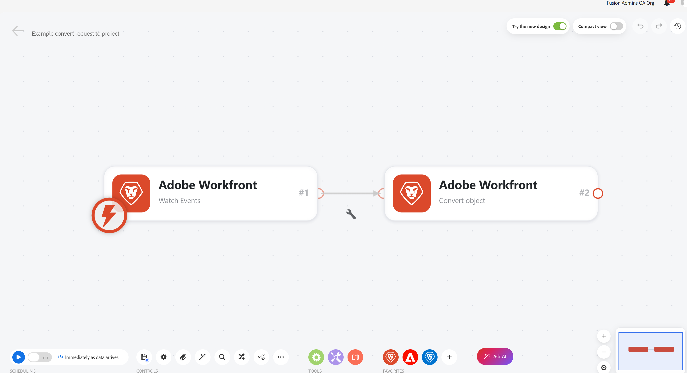
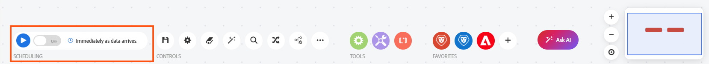
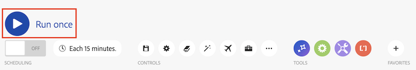

# シナリオエディター

シナリオエディターを使用すると、視覚的なインターフェイスでシナリオを作成および編集できます。

新しいシナリオエディターのエクスペリエンス：

従来のシナリオエディターでは

## アクセス要件

+++ 展開すると、この記事の機能のアクセス要件が表示されます。

<table style="table-layout:auto">
 <col> 
 <col> 
 <tbody> 
  <tr> 
   <td role="rowheader">Adobe Workfront パッケージ</td> 
   <td> 
任意の Adobe Workfront Workflow パッケージと任意の Adobe Workfront Automation および Integration パッケージ

Workfront Ultimate

Workfront Fusion を追加購入した Workfront Prime および Select パッケージ。
 </td> 
  </tr> 
  <tr data-mc-conditions=""> 
   <td role="rowheader">Adobe Workfront ライセンス</td> 
   <td> 
標準

Work またはそれ以上
 </td> 
  </tr> 
  <tr> 
   <td role="rowheader">製品</td> 
   <td>
   
組織が Workfront Automation および Integration を含まない Select またはPrime Workfront パッケージを持っている場合は、Adobe Workfront Fusion を購入する必要があります。</li></ul>
   </td> 
  </tr>
 </tbody> 
</table>

この表の情報について詳しくは、[ドキュメントのアクセス要件](/help/workfront-fusion/references/licenses-and-roles/access-level-requirements-in-documentation.md)を参照してください。

+++

## 新しい体験と従来の体験

Workfront Fusionは、シナリオエディターを新しいエクスペリエンスに移行中です。 この移行中は、従来のエクスペリエンスと新しいエクスペリエンスの両方を利用でき、いつでも切り替えることができます。 新しいエクスペリエンスを使用することをお勧めします。

新しいエクスペリエンスには次のものが含まれます。

* デザインを一新したキャンバス、カードスタイルのモジュール、ミニマップ、ズームコントロール。
* 検索と置換、スニペット、取り消し/やり直しなどの新しいシナリオエディターコントロール。
* 「AIに質問」ボタンを活用できます。
* カテゴリーナビゲーションと、お気に入りをインラインでマークする機能を備えた更新されたコネクタピッカー。
* アピアランス設定に従ったダークモード。
* ルーターを折りたたんでルートを非表示にする機能。
* [Live Trail](/help/workfront-fusion/manage-scenarios/live-trail.md)。シナリオ実行を表示するパネルです。
* シナリオエディターに組み込まれているいくつかの開発者ツール。
* 一時的なデバッグログ。シナリオ設定でオンにできます。

従来のエクスペリエンスと新しいエクスペリエンスを切り替えるには：

1. シナリオエディターで、右上隅の「**[!UICONTROL 新しいデザインを試す]**」トグルを見つけます。
1. 切り替えスイッチをクリックして、新しいエクスペリエンスに切り替えます。
1. クラシックエクスペリエンスに戻るには、もう一度トグルをクリックします。

切り替えると、シナリオが再読み込みされます。 選択した内容はユーザーに対して保存されるので、チームメイトに表示されるエクスペリエンスは変更されません。 切り替えても、シナリオ自体は変更されません。

切り替えスイッチが表示されない場合は、新しいエクスペリエンスがまだ組織で利用できない可能性があります。 Workfront Fusionの管理者にお問い合わせください。

## 新しいエクスペリエンスでシナリオエディターを使用する（推奨）

* [シナリオエディターを開き、モジュールを追加します。](#open-the-scenario-editor-and-add-a-module)
* [使用可能なシナリオエディターのアクション](#available-scenario-editor-actions)

### シナリオエディターを開き、モジュールを追加します。

1. 左側のパネルで「**[!UICONTROL シナリオ]** 」をクリックします。
1. プレースホルダーモジュールをクリックして、アプリとサービスのリストを開きます。
1. 最初に使用するアプリまたはサービスを選択します。

   * 左側のパネル（[!UICONTROL お気に入り]、[!UICONTROL すべてのアプリケーション &#x200B;]、[!UICONTROL Adobe Workfront]、[!UICONTROL Adobe Firefly Services]、[!UICONTROL Adobe Creativeとコンテンツ &#x200B;]、[!UICONTROL Adobe Cloud Services]、[!UICONTROL 生成AI]、または[!UICONTROL 組み込み]）を使用して、カテゴリ別に参照します。
   * 検索ボックスに用語を入力して、リストをフィルタリングします。
   * お気に入りにコネクタを追加するには、コネクタにカーソルを合わせて、コネクタの横にあるスターアイコンをクリックします。

   モジュールの設定について詳しくは、[&#x200B; モジュールの設定](/help/workfront-fusion/create-scenarios/add-modules/configure-a-modules-settings.md)を参照してください。

### 使用可能なシナリオエディターのアクション

* [アクションの編集](#editing-actions)
* [スケジュール設定](#scheduling)
* [コントロール](#controls)
* [ツール](#tools)
* [お気に入り](#favorites)
* [AIに質問](#ask-ai)
* [カンバスナビゲーション](#canvas-navigation)
* [カンバス表示](#canvas-display)

#### アクションの編集

これらのアクションは、下部のツールバーではなく、画面の上部で使用できます。

| アクション | 詳細 |
| ---------- | ---------- |
| シナリオ名 | シナリオの名前が画面の左上に表示されます。 シナリオの名前を変更するには、名前をクリックして新しい名前を入力します。 |
| コンパクトビュー | カンバス上のモジュールが小さいタイルに縮小され、グリッドが引き締められ、長いモジュール名が切り取られるのではなくラップされるビューを切り替えます。 ビューを切り替えても、シナリオは再読み込みされません。 |
| フィードバック | 新しいエクスペリエンスに関するフィードバックを送信します。 このボタンは、シナリオエディターの右上隅にあるコンパクトビュートグルの横にあります。 |
| 取り消し  | 最新のアクション、最新のアクションを元に戻します。 アクションは、現在のセッションからのみ取り消すことができます。 |
| やり直し  | 最近のアクションをやり直す。 現在のセッションからのみアクションをやり直すことができます。 |
| 履歴  | このセッションでおこなわれた変更履歴を表示します。 また、すべてのセッションの変更を取り消すこともできます。 |

#### スケジュール設定

| アクション | 詳細 |
| ---------- | ---------- |
| 1回実行 | 新しいデザインでは、「1回実行」はアイコンのみです。 アイコンにカーソルを合わせると、**[!UICONTROL 1回実行]**&#x200B;のツールヒントが表示されます。 ここでは、シナリオをテストして実行し、シナリオをアクティブ化する前に、シナリオが期待どおりに実行されることを確認できます |
| アクティベーション切り替え | シナリオをアクティブ化または非アクティブ化します。 アクティブ化すると、シナリオはそのスケジュールに従って実行されます。 |
| シナリオのスケジュール | デフォルトでは、ポーリングトリガーを持つシナリオは15分ごとに実行されます。 アクティブ化されたシナリオを実行するタイミングと頻度を定義することで、これを変更できます。 ポーリングされたフュージョンのシナリオは、5分ごとに実行するようにスケジュールできます。 詳細については、[&#x200B; シナリオのスケジュール &#x200B;](/help/workfront-fusion/create-scenarios/config-scenarios-settings/schedule-a-scenario.md)を参照してください。 |

#### コントロール

これらのコントロールの一部を表示するには、コントロール領域の3点アイコンをクリックする必要がある場合があります。

| アクション | 詳細 |
| ---------- | ---------- |
| 保存します。 

 | 
シナリオを保存した後、将来アクセスする必要がある場合、「...」メニューから新しいバージョンを使用できます。 以前に保存したシナリオのバージョンは、次のシナリオバージョンが作成されてから60日間使用できます。 

監査の目的で60日を超えるシナリオのバージョン履歴を保持するには、シナリオの設計図を別の場所に保存してアーカイブすることをお勧めします。
 |
| シナリオ設定 

 | シナリオ設定パネルには、シナリオの詳細設定が表示されます。 使用可能な設定について詳しくは、[&#x200B; シナリオ設定の設定](/help/workfront-fusion/create-scenarios/config-scenarios-settings/configure-scenario-settings.md)を参照してください。 リクエストとレスポンスの詳細は、実行ごとに保持されるわけではありません。 シナリオの通常の実行でこれらを収集するには、「一時デバッグログ」をオンにします。 詳しくは、[一時デバッグログ &#x200B;](/help/workfront-fusion/create-scenarios/config-scenarios-settings/configure-scenario-settings.md#temporary-debug-logs)を参照してください。 |
| メモ 

 | シナリオに関するメモを作成します。 他のユーザーは、シナリオ内にあるときに、これらのメモを表示できます。 詳細については、[&#x200B; シナリオにメモを追加](/help/workfront-fusion/create-scenarios/config-scenarios-settings/add-notes-to-scenario.md)を参照してください。 |
| 自動整列 

 | シナリオ内のモジュールを自動調整します。 |
| 検索モジュール 

 | そのリストからモジュールを選択して、シナリオでそのモジュールに移動するか、検索語を入力してモジュールを見つけ、そのモジュールに移動する検索結果をクリックします。 モジュール名、ID、タイプ、またはアプリケーションで検索できます。 |
| 検索と置換 

 | 
シナリオのモジュール全体で、変数、マッピングされた値ソース、接続を検索して置き換えます。 タブを使用して以下を行います。
<ul><li>シナリオ全体または1つのモジュール内で、マッピングされた変数を置き換えます。</li><li>あるソースモジュールから別のソースモジュールへの参照を再マップします。</li><li>同じアプリから1つまたはすべての互換性のあるモジュールに接続をコピーします。</li></ul>
パネルには、変更を行う前に影響を受けるモジュールがプレビューされます。 プレビューで行を選択して、キャンバス上のそのモジュールに移動します。
 
詳細については、[&#x200B; シナリオ内の変数、ソース、接続の検索と置換](/help/workfront-fusion/manage-scenarios/find-and-replace.md)を参照してください。
 |
| スニペット 

 | 
スニペットは、単位として保存されるシナリオセクションです。 作成するには、モジュールを選択し、スニペットとして保存します。 スニペットパネルでは、スニペットを検索、タグ付け、プレビュー、ピン留め、並べ替え、ドラッグ&amp;ドロップしたり、読み込んだり書き出したりできます。 スニペットは、チームや組織と共有したり、別のユーザーに直接コピーを送信したりできます。 共有スニペットはそれぞれのタブに表示されます。
 
詳しくは、[&#x200B; スニペットを使用したシナリオセクションの保存と再利用](/help/workfront-fusion/create-scenarios/add-modules/use-snippets.md)を参照してください。
 |
| フローを説明 

 | 動くドットがシナリオ内のデータの流れを示すアニメーションを表示します。 |
| ブループリントの書き出し 

 | 現在のシナリオのブループリントを書き出します。 詳しくは、[&#x200B; モジュールまたはシナリオのコピー](/help/workfront-fusion/create-scenarios/add-modules/copy-modules-or-scenarios.md)を参照してください。 |
| ヘッドレステンプレートとして書き出し 

 | シナリオをヘッドレステンプレートとして書き出します。 |
| ブループリントの読み込み 

 | 以前に書き出したシナリオブループリントを読み込みます。 詳しくは、[&#x200B; モジュールまたはシナリオのコピー](/help/workfront-fusion/create-scenarios/add-modules/copy-modules-or-scenarios.md)を参照してください。 |
| 開発ツール 

 | DevToolを使用すると、シナリオのすべての手動実行を確認し、実行されたすべての操作を確認し、実行されたすべてのAPI呼び出しの詳細を確認できます。 エラーが発生したモジュール、操作または単一の応答を確認し、その知識を使用してシナリオを改良できます。 詳しくは、[&#x200B; シナリオのデバッグ &#x200B;](/help/workfront-fusion/manage-scenarios/debug-a-scenario.md)を参照してください。 |
| 以前のバージョン 

 | このシナリオの以前のバージョンを表示します。 詳しくは、[&#x200B; シナリオバージョンの表示と管理](/help/workfront-fusion/manage-scenarios/restore-a-scenario-version.md)を参照してください。 |

#### ツール

| アクション | 詳細 |
| ---------- | ---------- |
| フロー制御 | シナリオ内のデータの流れを制御するための設定を構成します。 詳しくは、[&#x200B; フロー制御](/help/workfront-fusion/references/apps-and-modules/tools-and-transformers/flow-control.md)を参照してください。 |
| ツール | ツール セクションには、シナリオを強化するのに役立つモジュールがいくつか含まれています。 詳しくは、[&#x200B; ツール &#x200B;](/help/workfront-fusion/references/apps-and-modules/tools-and-transformers/tools-modules.md)を参照してください。 |
| テキストパーサー | テキスト解析ツールを使用して、他のシナリオモジュールで使用するテキストを解析します。 詳しくは、[&#x200B; テキストパーサー](/help/workfront-fusion/references/apps-and-modules/tools-and-transformers/text-parser.md)を参照してください。 |

#### お気に入り

「お気に入り」アイコンを使用して、頻繁に使用するモジュールを追加できます。

| アクション | 詳細 |
| ---------- | ---------- |
| お気に入りのコネクタ | お気に入りとしてマークしたコネクタがここに表示されます。 |
| お気に入りアイコンを追加 | このアイコンをクリックして、お気に入りセクションに追加する別のコネクタを選択します。 |
| オーバーフローアイコン | ツールバーに収まらないお気に入りが多い場合は、オーバーフロー（3点）アイコンが表示され、残りの部分にアクセスできます。 |

#### AIに質問

「**AIに質問**」をクリックして、Adobe AI アシスタントを開きます。 このオプションは、組織のAI設定によっては利用できない場合があります。

#### カンバスナビゲーション

| アクション | 詳細 |
| ---------- | ---------- |
| ズームイン / ズームアウト | カンバスビューを拡大または縮小します。 |
| Focus | 画面上のシナリオ全体に合ったビューに戻ります。 |
| ミニマップ | シナリオ全体のサムネール概要を表示します。 ミニマップは現在のビューポートを示します。 その中をクリックするか、クリック&amp;ドラッグしてカンバス内を移動します。 |

#### カンバス表示

新しいキャンバスでは、作業の際のシナリオの表示も変更されます。

| 機能 | 詳細 |
| ---------- | ---------- |
| モジュールカード | 各モジュールは、アプリアイコン、モジュール名、説明、モジュール IDを示す水平カードです。 ルーターはコンパクトなブランチタイルとして表示され、ディレクティブは小さなアクセントカードとして表示されます。 |
| リンク | モジュール間のリンクは、方向を示す矢印で曲がり、終了します。 エラーハンドラーのリンクは破線で表示されます。 |
| モジュールステータス | 各モジュールのステータスは、緑、黄色、赤のインジケーターで示されます。 |
| 詳細をズーム | ズームインすると、カードの詳細が表示されます。 ズームアウトすると、モジュールはアイコンに単純化されるので、シナリオ全体を引き続き表示できます。 |
| ルーターを折りたたむ | 編集モードでは、ルーターを折りたたんでルートを非表示にすることができます。 詳細については、「[&#x200B; ルーターを折りたたむ](/help/workfront-fusion/create-scenarios/add-modules/router-module.md#fold-a-router)」を参照してください。 |
| ダークモード | カンバスは、モジュールカード、リンク、パネル、コントロール、ステータス情報など、Adobe環境設定の暗いアピアランス設定に従います。 |
| 右側パネル | モジュールの設定、モジュールの検査、モジュールブラウザー、検索と置換、スニペット、[Live Trail](/help/workfront-fusion/manage-scenarios/live-trail.md)、リクエストと応答の詳細が、キャンバスの右側にある同じパネルで開きます。 |

## 従来のエクスペリエンスでのシナリオエディターの使用

* [シナリオエディターを開き、モジュールを追加します。（クラシック）](#open-the-scenario-editor-and-add-a-module-classic)
* [使用可能なシナリオエディターアクション（クラシック）](#available-scenario-editor-actions-classic)

### シナリオエディターを開き、モジュールを追加します。（クラシック）

1. 左側のパネルで「**[!UICONTROL シナリオ]** 」をクリックします。
1. 疑問符アイコン をクリックし、最初に使用するアプリまたはサービスを見つけてクリックします。 モジュールの設定について詳しくは、[&#x200B; モジュールの設定](/help/workfront-fusion/create-scenarios/add-modules/configure-a-modules-settings.md)を参照してください。

### 使用可能なシナリオエディターアクション（クラシック）

* [シナリオの実行（クラシック）](#run-your-scenario-classic)
* [スケジュール設定（クラシック）](#scheduling-classic)
* [コントロール（クラシック）](#controls-classic)
* [ツール （クラシック）](#tools-classic)
* [お気に入り（クラシック）](#favorites-classic)

#### シナリオの実行（クラシック）

| アクション | 詳細 |
|----------|----------|
| シナリオのテスト実行を行う | シナリオをアクティブ化する前に、シナリオが期待どおりに実行されていることを確認します。 アクティブ化すると、シナリオはスケジュールに従って実行されます。 すべてが期待どおりに実行されない場合は、[&#x200B; エラー処理の追加](/help/workfront-fusion/create-scenarios/config-error-handling/error-handling.md)を参照して、エラーの処理方法を確認してください。 |

#### スケジュール設定（クラシック）

| アクション | 詳細 |
| ---------- | ---------- |
| シナリオのスケジュール | デフォルトでは、シナリオは 15 分ごとに実行されます。 アクティブ化されたシナリオを実行するタイミングと頻度を定義することで、これを変更できます。 Fusion シナリオは、5 分ごとに実行するようにスケジュールできます。 詳細については、[&#x200B; シナリオのスケジュール &#x200B;](/help/workfront-fusion/create-scenarios/config-scenarios-settings/schedule-a-scenario.md)を参照してください。 |

#### コントロール（クラシック）

これらのコントロールの一部を表示するには、コントロール領域の3点アイコンをクリックする必要がある場合があります。

| アクション | 詳細 |
| ---------- | ---------- |
| 保存します。 

 | 
シナリオを保存した後、将来アクセスする必要がある場合、「...」メニューから新しいバージョンを使用できます。 以前に保存したシナリオのバージョンは、次のシナリオバージョンが作成されてから60日間使用できます。 

監査の目的で60日を超えるシナリオのバージョン履歴を保持するには、シナリオの設計図を別の場所に保存してアーカイブすることをお勧めします。
 |
| シナリオ設定 

 | シナリオ設定パネルには、シナリオの詳細設定が表示されます。 使用可能な設定について詳しくは、[&#x200B; シナリオ設定の設定](/help/workfront-fusion/create-scenarios/config-scenarios-settings/configure-scenario-settings.md)を参照してください。 |
| メモ  

 | シナリオに関するメモを作成します。 他のユーザーは、シナリオ内にあるときに、これらのメモを表示できます。 |
| 自動整列 

 | シナリオ内のモジュールを自動調整します。 |
| 検索モジュール 
  
 | モジュールを検索するための検索語句を入力し、そのモジュールに移動する検索結果をクリックします。 モジュール名、ID、タイプ、またはアプリケーションで検索できます。 |
| フローを説明  
 
 | 動くドットがシナリオ内のデータの流れを示すアニメーションを表示します。 |
| 開発ツール 

 | DevToolを使用すると、シナリオのすべての手動実行を確認し、実行されたすべての操作を確認し、実行されたすべてのAPI呼び出しの詳細を確認できます。 エラーが発生したモジュール、操作または単一の応答を確認し、その知識を使用してシナリオを改良できます。 詳しくは、[&#x200B; シナリオのデバッグ &#x200B;](/help/workfront-fusion/manage-scenarios/debug-a-scenario.md)を参照してください。 |
| ブループリントの書き出し  
 
 | 現在のシナリオのブループリントを書き出します。 |
| ヘッドレステンプレートとして書き出し  
 
 | シナリオをヘッドレステンプレートとして書き出します。 |
| ブループリントの読み込み  
 
 | 以前に書き出したシナリオブループリントを読み込みます。 |
| 以前のバージョン  
 
 | このシナリオの以前のバージョンを表示します。 |

#### ツール （クラシック）

| アクション | 詳細 |
| ---------- | ---------- |
| フロー制御 | データの流れを制御するための設定を構成します。 詳しくは、[&#x200B; フロー制御](/help/workfront-fusion/references/apps-and-modules/tools-and-transformers/flow-control.md)を参照してください。 |
| ツール | ツール セクションには、シナリオを強化するのに役立つモジュールがいくつか含まれています。 詳しくは、[&#x200B; ツール &#x200B;](/help/workfront-fusion/references/apps-and-modules/tools-and-transformers/tools-modules.md)を参照してください。 |
| テキストパーサー | テキスト解析ツールを使用して、他のシナリオモジュールで使用するテキストを解析します。 テキストパーサーには接続は必要ありません。 詳しくは、[&#x200B; テキストパーサー](/help/workfront-fusion/references/apps-and-modules/tools-and-transformers/text-parser.md)を参照してください。 |

#### お気に入り（クラシック）

「お気に入り」アイコンを使用して、頻繁に使用するモジュールを追加できます。

