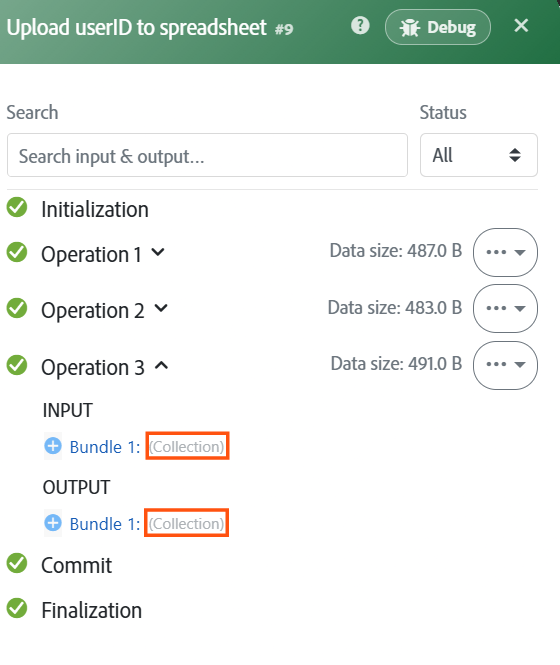

# マッピングの概要

マッピングとは、あるモジュールの出力を別のモジュールの入力フィールドに割り当てるプロセスです。

モジュールの操作により、その出力として 0 個、1 個または複数のバンドルが生成されます。 バンドルは、1 つ以上の項目で構成されます。

これらの項目は、後のモジュールのフィールドにマッピングできます。

>[!NOTE]
>
>Workfront Fusionは、シナリオエディターを新しいエクスペリエンスに移行中です。 この移行中は、従来のエクスペリエンスと新しいエクスペリエンスの両方を利用でき、いつでも切り替えることができます。 新しいエクスペリエンスを使用することをお勧めします。 詳しくは、シナリオエディターの記事「[新しいエクスペリエンスと従来のエクスペリエンス &#x200B;](/help/workfront-fusion/get-started-with-fusion/navigate-fusion/scenario-editor.md#new-and-classic-experiences)」を参照してください。

シナリオで前のモジュールから出力された値を挿入するフィールドをクリックすると、マッピングパネルが表示されます。 ここでは、マッピングする項目を選択できます。 マッピングには、次のうち 1 つ以上を含めることができます。

* 単一の項目
* 複数の項目
* 静的テキスト
* 関数

>[!BEGINSHADEBOX]

**例**:

単一の項目

テキストを含む複数の項目

複数の項目とテキストを含む関数

>[!ENDSHADEBOX]

マッピングの手順について詳しくは、[データのマッピング：記事インデックス](/help/workfront-fusion/create-scenarios/map-data/map-data-toc.md)の記事を参照してください。

>[!NOTE]
>
>[!UICONTROL イテレータ]および[!UICONTROL アグリゲータ]間でラップされたモジュールの出力は、[!UICONTROL アグリゲータ]モジュールから先にはアクセスできません。

## マッピングパネル

データをマッピングできるフィールドをクリックすると、マッピングパネルが開きます。

最初のタブには、他のモジュールからマッピングできる項目が表示されます。

その他のタブには、数式の作成に使用できる関数、演算子およびキーワードが含まれます。 これらは、処理するデータのタイプに基づいて異なるタブに並べ替えられます。

関数タブについて詳しくは、[関数の概要](/help/workfront-fusion/get-started-with-fusion/understand-fusion/function-overview.md)を参照してください。

関数を使用したアイテムのマッピングについて詳しくは、[組み込み関数を使用したアイテムのマッピング &#x200B;](/help/workfront-fusion/create-scenarios/map-data/map-using-functions.md)を参照してください。

## コレクション

項目には、様々なタイプの複数の値を含めることができます。 これらはコレクションタイプの項目です。

コレクションタイプのバンドルは、モジュール出力のバンドルラベルの横に `(Collection)` を表示します。

ほとんどの場合、コレクション全体を表す項目ではなく、コレクションの要素をマッピングします。

マッピングパネルでコレクションの要素を見つけるには、コレクションの横にある矢印をクリックします。

配列について詳しくは、[項目データタイプ](/help/workfront-fusion/references/mapping-panel/data-types/item-data-types.md)を参照してください。

コレクションのマッピング手順について詳しくは、モジュール間での情報のマッピングの記事の[項目のマッピング](/help/workfront-fusion/create-scenarios/map-data/map-data-from-one-to-another.md#map-an-item)を参照してください。

## 配列

項目には、同じタイプの複数の値を含めることができます。 これらは配列タイプの項目です。

配列タイプのバンドルは、モジュール出力のバンドルラベルの横に `(Array)` を表示します。

マッピングパネルでは、配列は角括弧で表示されます。 配列タイプの項目は、項目のラベルの末尾にある角括弧で識別できます。 マッピングパネルで特定の配列要素を見つけるには、配列の横にある矢印をクリックします。

配列および配列要素のマッピングについて詳しくは、[配列および配列要素のマッピング](/help/workfront-fusion/create-scenarios/map-data/map-an-array.md)を参照してください。
